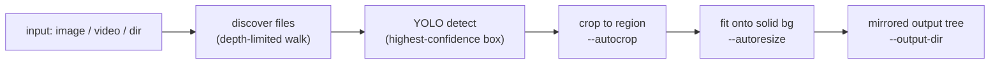

# Cropping & resizing screenshots with screencrop-media

Twitter/X screenshots dropped into a chat or a dataset almost always need two
things before they're shareable: cropping down to the actual tweet region,
and resizing onto a consistent solid background so a grid of them looks
uniform. `screencrop-media` does both in one pass — `--autocrop` runs this
repo's YOLO detector to find the tweet region and crop to it, `--autoresize`
fits the (possibly cropped) image onto a solid background at a target size.
It never touches your inputs: every artifact is written into a separate
`--output-dir` that mirrors the input subtree. It's the batch/CLI sibling of
[demo.md](demo.md) (visual smoke-testing a model) — see
[../specs/screencropnet-media.md](../specs/screencropnet-media.md) for the
full spec.

## What you'll build

A pipeline that discovers media (one file, or a directory to some depth),
detects the tweet region with YOLO, crops to the highest-confidence box,
fits the result onto a solid background, and writes everything into a
mirrored output tree — leaving the input directory untouched.



## Prerequisites

| Requirement | Notes |
| --- | --- |
| [uv](https://docs.astral.sh/uv/) | Dependency manager — this project never uses `pip`/`python` directly. See [installation.md](installation.md). |
| Python 3.11–3.13 | `uv` fetches a matching interpreter if you don't have one. |
| A trained or pretrained YOLO checkpoint | `--latest` picks up `runs/*/train/weights/best.pt`; a base pretrained checkpoint also works via config defaults. Only needed for `--autocrop`. |
| `ffmpeg` / `ffprobe` binaries | Only for the video path (crop/resize a clip) and `--info` on a video. Install with `brew install ffmpeg`. |
| `fzf` binary | Only for `--select`/`--fuzzy`. Install with `brew install fzf`. |

> `ffmpeg`/`ffprobe` are system prerequisites, not Python dependencies — the
> video path shells out to them directly, and `--info` on a video reads
> duration/fps/codec via `ffprobe`. Image crop and resize use
> OpenCV and need neither binary. `fzf` is likewise a separate binary the
> `--select`/`--fuzzy` picker shells out to; every other flag combination
> runs fine without it.

## Step 1 — Install and check the CLI

```bash
git clone https://github.com/bossjones/screencropnet_yolov11.git
cd screencropnet_yolov11
make install                     # uv sync --all-extras
uv run screencrop-media --help   # confirm the console script is on PATH
```

Two equivalent invocation forms exist; this tutorial uses the console
script throughout, but the module form works identically:

```bash
uv run python -m screencropnet_yolo.media <input> [options]
```

## Step 2 — Inspect metadata with --info

Before processing anything, point `--info` at the bundled test-image folder
to see what the tool discovers — `--info` prints metadata and exits, doing
no cropping or resizing:

```bash
uv run screencrop-media datasets/twitter_screenshots_localization_dataset/test/images --info
```

You'll get a table of path, kind, dimensions, and byte size for each image.
Add `--json` when you want the same data piped into another tool instead of
rendered as a table:

```bash
uv run screencrop-media datasets/twitter_screenshots_localization_dataset/test/images --info --json
```

`--info` never loads a model — it's pure filesystem/`cv2` inspection (plus
`ffprobe` for video), so it's the fastest way to sanity-check a folder
before committing to a full run.

## Step 3 — Crop a single screenshot

`--autocrop` is the piece that needs a model: it runs YOLO detection, takes
the single highest-confidence box, and crops to it. `--latest` picks up the
newest trained `best.pt` under `runs/`:

```bash
uv run screencrop-media datasets/twitter_screenshots_localization_dataset/test/images/00019_twitter.PNG \
  --autocrop --latest
```

Look under the default output directory — `screencrop-media --autocrop`
never writes next to the input, so nothing in
`datasets/twitter_screenshots_localization_dataset/` changes:

```bash
ls ./screencrop-media-out/
# cropped-00019_twitter.PNG
```

The `cropped-` prefix tells you which operation produced the file — that
naming convention is consistent across every mode (see Step 4).

## Step 4 — Resize onto a solid background

`--autoresize` fits the (possibly cropped) image onto a solid background at
a target size — it does **not** need a model on its own, since it only
touches whatever `--autocrop` handed it (or the original image, if
`--autocrop` was omitted). Combine both to crop first, then resize the crop:

```bash
uv run screencrop-media datasets/twitter_screenshots_localization_dataset/test/images/00019_twitter.PNG \
  --autocrop --autoresize --latest
# -> ./screencrop-media-out/cropped-resized-00019_twitter.PNG (1080x1350, portrait 4:5)
```

1080×1350 is the default when `--autoresize` is set and no size is given.
`--square` shortcuts to 1080×1080 — handy for a uniform Instagram-style grid:

```bash
uv run screencrop-media datasets/twitter_screenshots_localization_dataset/test/images/00019_twitter.PNG \
  --autocrop --autoresize --square --latest
```

Background color is auto-detected: a pure-white top-left pixel gets a white
background, otherwise the tool falls back to the Twitter/Discord dark theme
color `#16202A`. Override it explicitly with `--bg-color` when you want a
specific brand color regardless of what the source image looks like:

```bash
uv run screencrop-media datasets/twitter_screenshots_localization_dataset/test/images/00019_twitter.PNG \
  --autocrop --autoresize --bg-color '#16202A' --latest
```

`--size WxH` and `--width`/`--height` are also available for one-off custom
targets — see the spec for the full precedence rules between them.

## Step 5 — Process a whole folder

Point the same command at a directory instead of a file, writing into an
output directory **outside** the input tree — `screencrop-media` refuses to
run if `--output-dir` resolves inside the input directory, so a fresh
scratch path is the safe default:

```bash
uv run screencrop-media datasets/twitter_screenshots_localization_dataset/test/images \
  --autocrop --autoresize --latest \
  --depth 0 \
  --output-dir /tmp/media-out
```

`--depth 0` (the default) means "top level only" — the 34 PNGs directly in
that folder, no subdirectories. Bump it to walk further down:

```bash
uv run screencrop-media datasets/twitter_screenshots_localization_dataset/test/images \
  --autocrop --latest \
  --depth 1 \
  --output-dir /tmp/media-out
```

Whatever subtree structure exists under the input root is mirrored under
`--output-dir`, so nested folders don't collide with each other's output —
and because inputs are never mutated, you can rerun with different flags
against the same source folder as many times as you like.

## Step 6 — Crop a video clip

The video path is the one place `screencrop-media` needs `ffmpeg`/`ffprobe`
on `PATH`. Detection samples up to five frames, unions the boxes into a
**single static crop rectangle** for the whole clip (no per-frame jitter),
and ffmpeg re-encodes with libx264, copying the audio track through
unchanged:

```bash
uv run screencrop-media ~/Downloads/clip.mp4 \
  --autocrop --autoresize --square --latest
# -> ./screencrop-media-out/cropped-resized-clip.mp4
```

`--autocrop` alone on a video skips the `scale`/`pad` filters and just
applies the crop rect; `--autoresize` alone skips the crop and applies the
resize-onto-background filters to the whole frame.

## Step 7 — Pick a model interactively (optional)

Instead of `--latest`, fuzzy-pick any `.pt`/`.onnx` checkpoint under `runs/`
with `fzf` — this reuses the same picker as `screencrop-demo --select`, so if
you've already used that CLI the experience is identical (see
[demo.md](demo.md) for how the picker lists and ranks candidates):

```bash
uv run screencrop-media datasets/twitter_screenshots_localization_dataset/test/images/00019_twitter.PNG \
  --autocrop --select
```

`--select`, `--model`, and `--latest` are resolved by precedence, not
validated against each other: `--select` wins over `--model`, which wins over
`--latest`, which falls back to the config's checkpoint. Passing more than one
won't error — the highest-precedence flag simply takes effect — but pick a
single one to keep the run unambiguous.

## Troubleshooting

| Symptom | Fix |
| --- | --- |
| `--select`/`--fuzzy` errors that `fzf` isn't found | `brew install fzf`, or bypass the picker with `--model PATH` / `--latest`. |
| Video crop/resize fails with an ffmpeg/ffprobe error | `brew install ffmpeg` — the video path and `--info` on video both shell out to these binaries; image-only runs don't need them. |
| Tool refuses to run: output dir inside input | Point `--output-dir` somewhere outside the input tree, e.g. `/tmp/media-out`. |
| No files found in a directory | Check `--depth` — the default `0` is top-level only; increase it, or confirm the extensions match (`.png` `.jpg` `.jpeg` `.webp` `.bmp` for images, `.mp4` `.mov` `.mkv` `.webm` `.gif` for video). |
| `--autocrop` errors that no model was found | `--latest` requires a `best.pt` under `runs/`; otherwise pass `--model PATH` explicitly or fall back to the config's pretrained checkpoint. |
| Output filenames aren't what I expected | The prefix encodes the operation: `cropped-`, `resized-`, `cropped-resized-`, or no prefix at all (passthrough copy) when neither flag is set. |

## Where to go next

- [../specs/screencropnet-media.md](../specs/screencropnet-media.md) — full
  flag reference, processing model, and output-layout spec.
- [demo.md](demo.md) — the visual smoke-test CLI that shares the same model
  picker and async-inference discipline.
- [usage.md](usage.md) — the underlying `InferencePipeline`/`Detection` API
  that both `demo` and `screencrop-media` build on.
- [installation.md](installation.md) — full `uv`/Python setup if Step 1 hit
  a snag.
